# Diagrama do Banco de Dados — Celore DMS

Diagrama Entidade-Relacionamento (ER) do banco `dealership`, com as **25 tabelas** organizadas por módulo e as relações (chaves estrangeiras) entre elas.

> Este arquivo renderiza automaticamente como diagrama no GitHub. Para exportar como imagem (PNG/SVG), cole o bloco de código abaixo em [mermaid.live](https://mermaid.live).

## Como ler o diagrama

Cada caixa é uma **tabela**. `PK` = chave primária (identificador único), `FK` = chave estrangeira (aponta para outra tabela). As linhas mostram as relações:

- `||--o{` → **um-para-muitos** (ex.: um cliente tem muitas ordens de serviço)
- `||--o|` → **um-para-um** opcional (ex.: um veículo tem no máximo um registro de localização)

Tabelas com nomes terminados em `Item` (ou como `ServicePart`, `UserFavorite`) são **tabelas de junção**, que resolvem relações muitos-para-muitos.

## Diagrama

```mermaid
erDiagram
    %% ===== Cadastros base =====
    Customer {
        int Customer_ID PK
        string Name
        string Email
        string P_Number
        enum Type
    }
    Employee {
        int Employee_ID PK
        string Name
        enum Type
    }
    Vehicle {
        char VIN PK
        string Make
        string Model
        int Year
        decimal Price
        enum Status
    }
    Inventory {
        char VIN FK
        string Location
    }
    Supplier {
        int Supplier_ID PK
        string Name
        string CNPJ
    }

    %% ===== Peças & Estoque =====
    Part {
        int Part_ID PK
        string Code
        string Description
        decimal Sale_Price
        int Min_Stock
    }
    StockMovement {
        int Movement_ID PK
        int Part_ID FK
        enum Type
        int Quantity
        enum Origin
    }
    PurchaseOrder {
        int PO_ID PK
        int Supplier_ID FK
        date Order_Date
        enum Status
    }
    PurchaseOrderItem {
        int PO_ID FK
        int Part_ID FK
        int Quantity
        decimal Unit_Cost
    }
    Requisition {
        int Req_ID PK
        int Employee_ID FK
        int Serv_ID FK
        enum Status
    }
    RequisitionItem {
        int Req_ID FK
        int Part_ID FK
        int Quantity
    }

    %% ===== Oficina & Pós-vendas =====
    Service {
        int Service_ID PK
        char VIN FK
        int C_ID FK
        enum Status
        decimal Final_Cost
    }
    ServiceEmployee {
        int Serv_ID FK
        int E_ID FK
    }
    ServicePart {
        int Serv_ID FK
        int Part_ID FK
        int Quantity
        decimal Unit_Price
    }
    Appointment {
        int Appointment_ID PK
        int C_ID FK
        char VIN FK
        int Employee_ID FK
        datetime Scheduled_For
        enum Status
    }
    Revision {
        int Revision_ID PK
        char VIN FK
        int Serv_ID FK
        int Plan_Mileage
        enum Status
    }
    Warranty {
        int Warranty_ID PK
        enum Coverage
        char VIN FK
        int Part_ID FK
        int Serv_ID FK
    }

    %% ===== Comercial =====
    Sales {
        int Sale_ID PK
        char VIN FK
        int C_ID FK
        date Date
    }
    Quote {
        int Quote_ID PK
        int C_ID FK
        char VIN FK
        enum Type
        enum Status
    }
    Reservation {
        int Reservation_ID PK
        char VIN FK
        int C_ID FK
        enum Status
    }

    %% ===== Fiscal & Financeiro =====
    Billing {
        int Billing_ID PK
        int Sale_ID FK
        int Serv_ID FK
        int C_ID FK
        string Payment_Method
    }
    Invoice {
        int Invoice_ID PK
        string Number
        enum Kind
        int Sale_ID FK
        int Serv_ID FK
        int PO_ID FK
        decimal Total
    }
    AccountEntry {
        int Entry_ID PK
        enum Direction
        int C_ID FK
        int Supplier_ID FK
        int Invoice_ID FK
        decimal Amount
    }

    %% ===== Sistema =====
    AppUser {
        int User_ID PK
        int Employee_ID FK
        string Username
        enum Role
    }
    UserFavorite {
        int User_ID FK
        string Function_Key
        int Position
    }

    %% ===== Relações =====
    Customer   ||--o{ Service       : atende
    Customer   ||--o{ Sales         : compra
    Customer   ||--o{ Appointment   : agenda
    Customer   ||--o{ Quote         : recebe
    Customer   ||--o{ Reservation   : reserva
    Customer   ||--o{ Billing       : paga
    Customer   ||--o{ AccountEntry  : deve

    Employee   ||--o{ ServiceEmployee : executa
    Employee   ||--o{ AppUser         : possui
    Employee   ||--o{ Requisition     : solicita
    Employee   ||--o{ Appointment     : responsavel

    Vehicle    ||--o| Inventory     : localizado
    Vehicle    ||--o{ Service       : recebe
    Vehicle    ||--o{ Sales         : vendido
    Vehicle    ||--o{ Appointment   : agendado
    Vehicle    ||--o{ Revision      : revisado
    Vehicle    ||--o{ Warranty      : cobre
    Vehicle    ||--o{ Quote         : cotado
    Vehicle    ||--o{ Reservation   : reservado

    Service    ||--o{ ServiceEmployee : tem
    Service    ||--o{ ServicePart     : usa
    Service    ||--o{ Requisition     : gera
    Service    ||--o{ Revision        : cumpre
    Service    ||--o{ Warranty        : garante
    Service    ||--o{ Billing         : fatura
    Service    ||--o{ Invoice         : emite

    Sales      ||--o{ Billing       : fatura
    Sales      ||--o{ Invoice       : emite

    Part       ||--o{ StockMovement     : movimenta
    Part       ||--o{ ServicePart       : aplicada
    Part       ||--o{ PurchaseOrderItem : comprada
    Part       ||--o{ RequisitionItem   : requisitada
    Part       ||--o{ Warranty          : garante

    Supplier   ||--o{ PurchaseOrder : fornece
    Supplier   ||--o{ AccountEntry  : recebe

    PurchaseOrder ||--o{ PurchaseOrderItem : contem
    PurchaseOrder ||--o{ Invoice           : gera

    Requisition ||--o{ RequisitionItem : contem
    AppUser     ||--o{ UserFavorite    : fixa
    Invoice     ||--o{ AccountEntry    : origina
```

## Resumo dos módulos

| Módulo | Tabelas |
|---|---|
| **Cadastros base** | Customer, Employee, Vehicle, Inventory, Supplier |
| **Peças & Estoque** | Part, StockMovement, PurchaseOrder, PurchaseOrderItem, Requisition, RequisitionItem |
| **Oficina & Pós-vendas** | Service, ServiceEmployee, ServicePart, Appointment, Revision, Warranty |
| **Comercial** | Sales, Quote, Reservation |
| **Fiscal & Financeiro** | Billing, Invoice, AccountEntry |
| **Sistema** | AppUser, UserFavorite |

## Views (relatórios derivados)

Além das tabelas, o banco tem **8 views** — consultas que calculam informação a partir das tabelas, sem duplicar dados:

- `PartStock` — saldo atual de cada peça (soma de `StockMovement`)
- `KardexView` — extrato de movimentações de cada peça, com saldo acumulado
- `AccountStatement` — extrato de contas a pagar e receber
- `CustomerLedger` — ficha financeira por cliente
- `Mechanic`, `SalespersonInv`, `SalespersonSales`, `BillingView` — views operacionais herdadas da base
